# Visual walkthrough

Every Atlas surface, in the order a draw passes through them — which
means consumer and operator screens interleave rather than being grouped
by platform. Someone has to enter before an operator can close, and the
winner claims after the reveal.

Captured from a running local stack: real Postgres, six registered
consumers, a genuine commit-reveal cycle. Nothing here is a mockup.

| | |
|---|---|
| Web surfaces | Playwright against the running admin, in `docs/screens/` |
| Mobile surfaces | Flutter goldens, in `mobile/test/design/goldens/` |
| Mobile, live | iOS simulator against the running stack, in `docs/screens/mobile-*` |
| Regenerate web | `infrastructure/scripts/capture_screens.py` |
| Regenerate mobile | `cd mobile && flutter test test/design/screen_goldens_test.dart --update-goldens` |
| Re-record the live capture | `cd mobile && flutter test integration_test/walkthrough_test.dart -d SIMULATOR_ID` |

Because the mobile shots are goldens, a UI change shows up as an image
diff in the pull request that caused it.

## 1 · The promise, before anyone has entered

The public surface exists to be checked by someone who does not trust you. It states the skill question and the commit-reveal proof up front rather than burying them.

> **Screenshots predate 2026-11-23.** They show the free-entry route sections, which have since been removed from `/how-it-works`, and the pre-correction responsible-play copy (see REVIEW-002 §6). Re-capture before this document is shown to anyone external.

### How it works

`public`

The commit-reveal protocol in plain language. The page positions Atlas as a prize competition and explains the skill question. The free-entry-route section shown in this screenshot was removed on 2026-11-23.

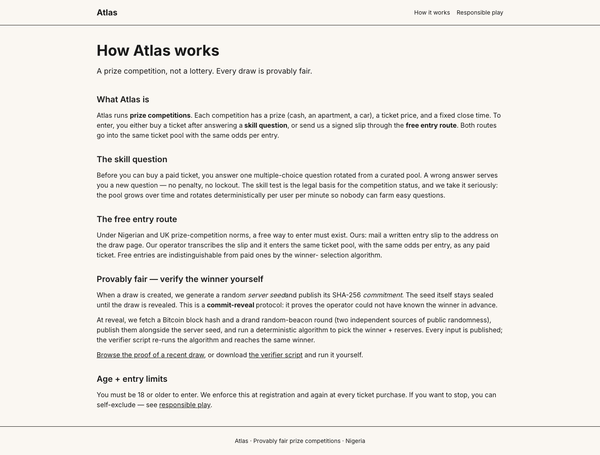

### Responsible play

`public`

Self-exclusion and spend limits. Required by the positioning, not bolted on after.

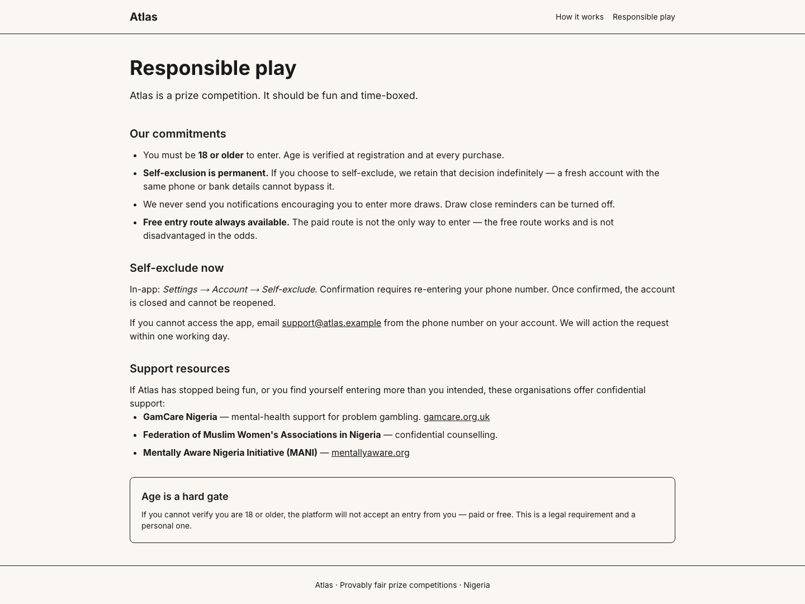

### Public proof — sealed

`sealed`

The commitment (SHA-256 of the server seed and draw id) is published when the draw is created. The seed itself is withheld and encrypted at rest. Anyone can record this hash now and hold Atlas to it later.

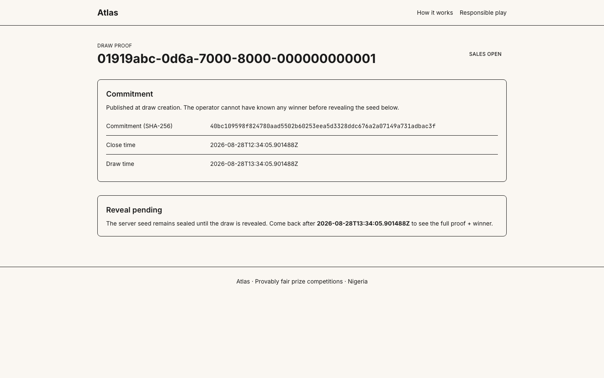

## 2 · Entering — the consumer, on mobile

Nothing can be closed or revealed until people have entered, so this comes before the operator surfaces rather than after them.

### Register

`sales_open`

The +234 prefix is fixed rather than a country picker, date of birth gates at 18, and terms are an explicit checkbox rather than implied consent.

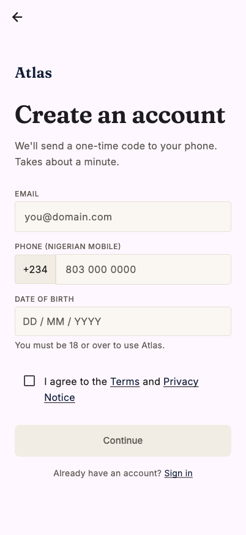

### One-time code

`sales_open`

Delivered to Mailhog in V0.5 rather than by SMS.

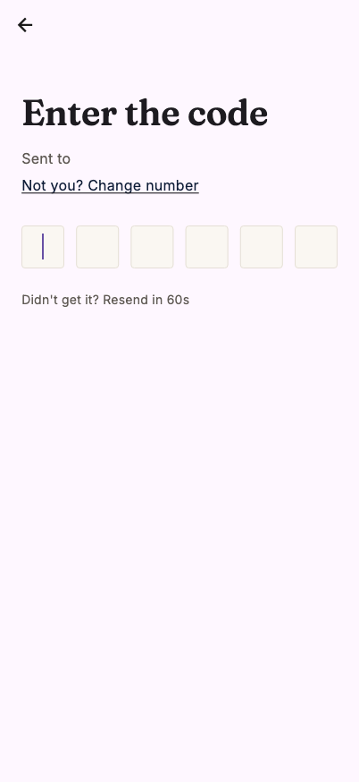

### Set a password

`sales_open`

Two rules gate the button — ten characters, and a mix of letters and numbers. The third line is advisory and always passes.

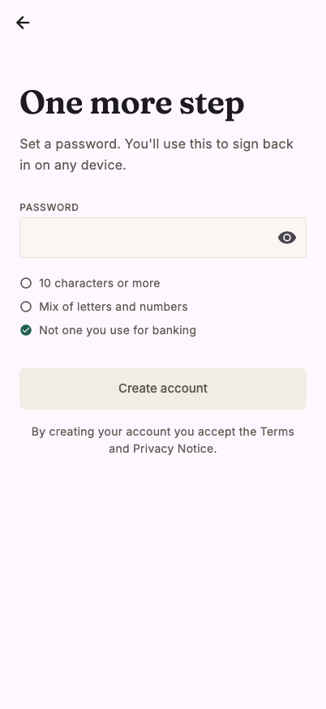

### Welcome

`sales_open`

Auto-advances to Home after 800ms, which is why its golden is captured at 300ms.

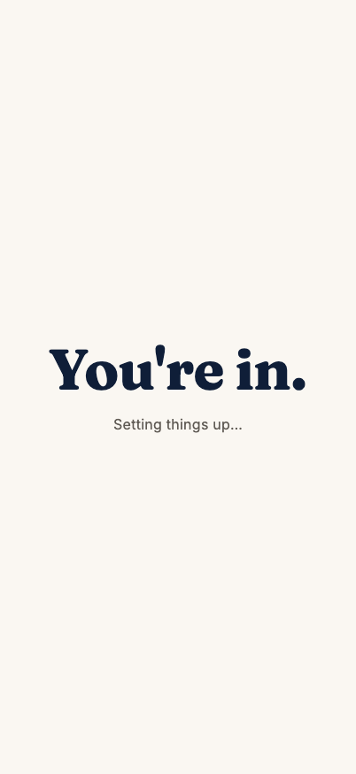

### Home

`sales_open`

Wallet chip, the active draw, and the commitment shown to the consumer before the reveal — the same hash the public proof page publishes.

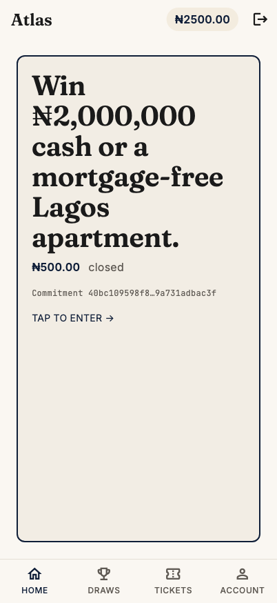

### Buying an entry

`sales_open`

Prize, price, and what happens next — stated before the purchase action, including that entries are not refundable once the draw closes.

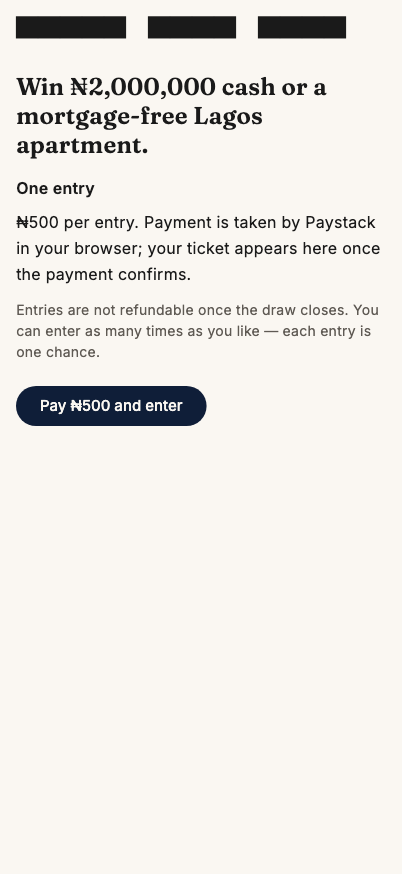

> **This screen replaced a skill question on 2026-11-26** (AMEND-003). The earlier
> version of this page said the skill question "is the mechanism that makes Atlas a
> prize competition rather than a lottery". That is no longer Atlas's position: the
> 2026-11-23 research found no skill carve-out in the governing State law, the free
> entry route had already been removed on 2026-11-23, and lawfulness now rests on
> holding a State gaming licence rather than on any draw mechanic. See PRD §1.

### Browsing concurrent draws — live capture

`sales_open`

Everything above is a golden: a single screen, rendered headlessly. This
section is different — it is an **iOS simulator running the real app
against the real backend**, driven by `integration_test/walkthrough_test.dart`
and recorded while it ran. The prize photography, the countdowns and the
commitment hashes are all live data.

Four draws are open. They arrive from `GET /api/v1/draws` ordered by
`close_time` ascending, so the one closing soonest leads — urgency drives
position without any urgency copy.

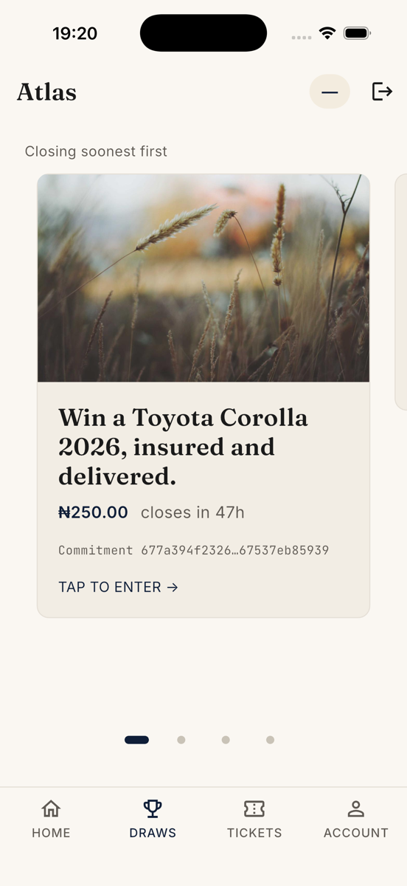

Swiping advances through them. The next card is deliberately left peeking
at the edge: without that, a carousel reads as a single static card and
nobody swipes.

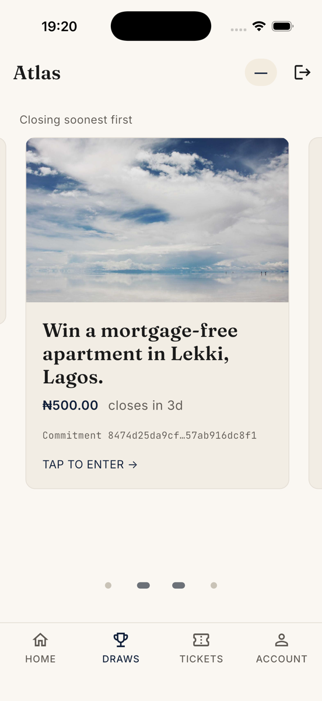

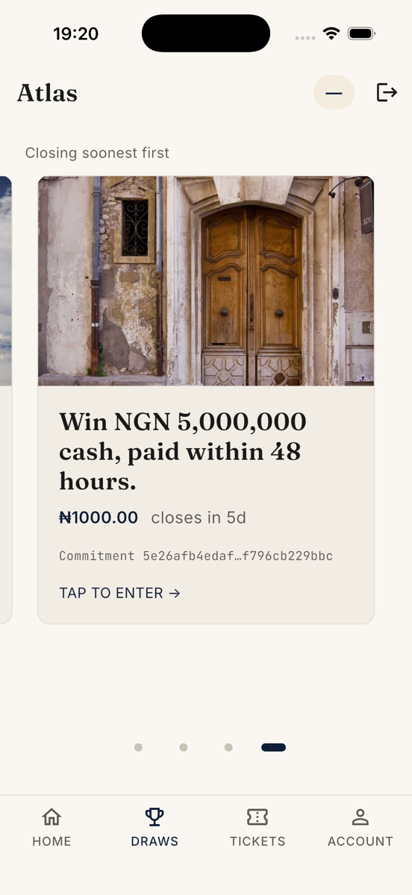

Watch the page indicator across the three shots. **The dots are controls,
not decoration** — 44pt touch targets with semantics labels, so every draw
is reachable without a horizontal drag, and each page announces its
position to a screen reader. A test asserts it: removing the dots' tap
handler fails `every draw is reachable WITHOUT swiping` and nothing else.

#### The recording

[`screens/draws-walkthrough.mp4`](screens/draws-walkthrough.mp4) — the
same sequence as video: four draws browsed forward, then back to the first
via the page indicator rather than by swiping.

#### Two things this capture does not show, and should not be read as showing

**It is not a sign-in.** There is no sign-in flow in the app. `identityApi.login`
is called in exactly one place — at the end of registration, in
`identity_controller.submitPassword` — and the *"Already have an account? Sign in"*
text on the registration screen has no tap handler. A returning user whose
8-hour session has lapsed has no route back into their account. The capture
harness reaches this screen by temporarily routing the app past the splash
router; that hack is reverted and is not in the shipped code. **Recorded here
as a gap, not worked around.**

**The photography is not on `main`.** `prize_image_url` and the full-bleed card
treatment live on `spike/prize-photography`, which is deliberately unmerged —
it adds a database column, and a bare URL column trusts whatever an operator
pastes into it. See `planning-artifacts/prize-photography-scope.md`. On `main`
today these cards render the text-only fallback. The images themselves are
Lorem Picsum placeholders standing in for real prize photography; they prove
the *treatment*, not content fit.

---

## 3 · Closing and revealing — the operator

A draw moves through a state machine and the console offers only the actions the current state permits. Watch the action set change on the same screen across the next four shots — that is the machine, not a tour of it.

### Operator login

`auth`

Reaching `/` redirects here. Until W8 the middleware guard was never loaded — it sat one directory above the app — so `/` returned 404 and the guard did nothing.

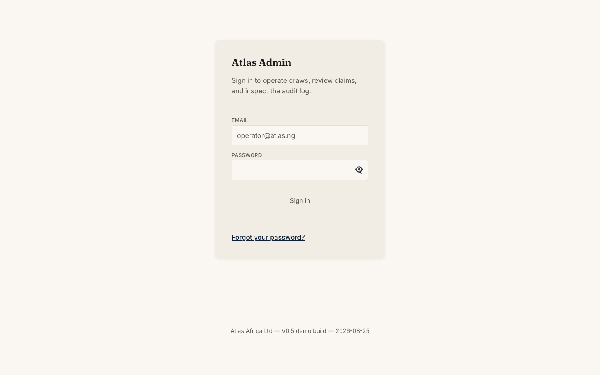

### Dashboard

`auth`

Landing surface after sign-in.

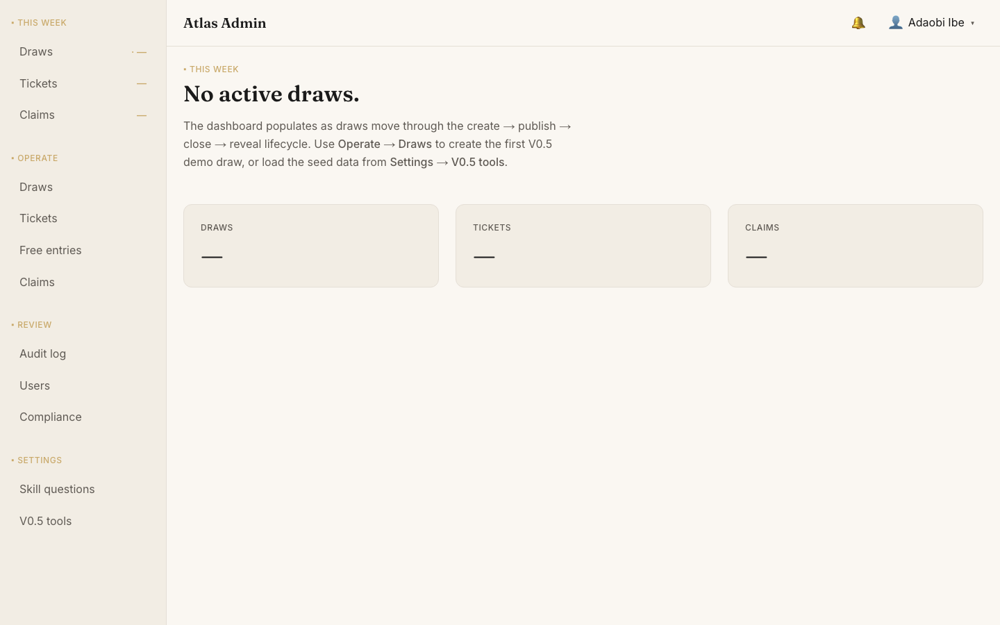

### Draws

`index`

The operator draw index. The sidebar shows the full planned operator surface; seven of those links have no page yet and 404 today.

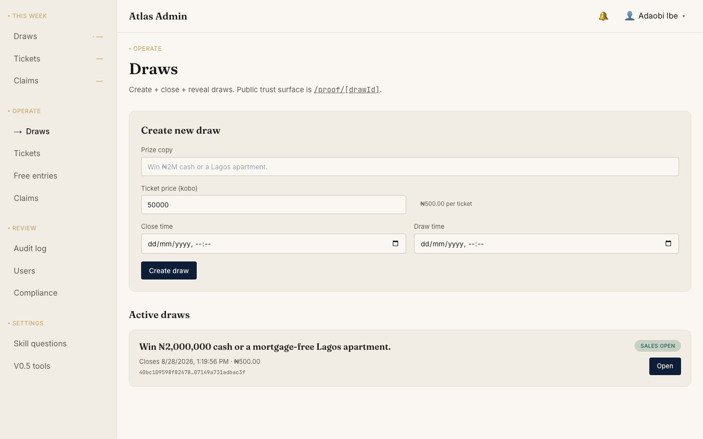

### Draw detail — sales open

`sales_open`

The commitment is shown to the operator pre-reveal, the same value the public page carries. Only **Close draw** is offered; reveal is not reachable from this state.

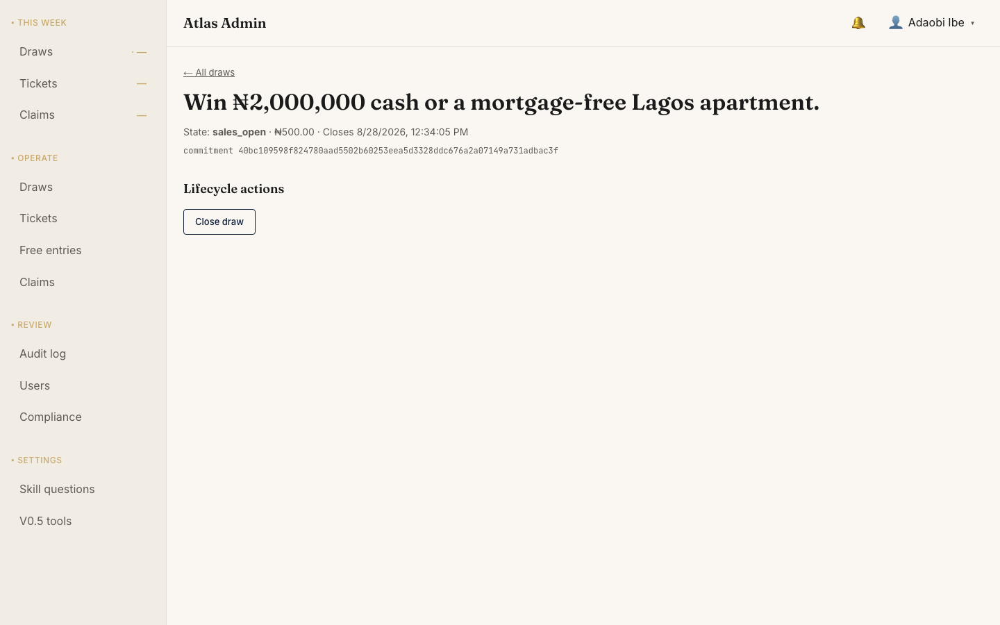

### Confirming an irreversible action

`sales_open`

Every lifecycle action is two-step. The copy says *this is not reversible* because it is not — a closed draw cannot reopen and a revealed one cannot be re-revealed.

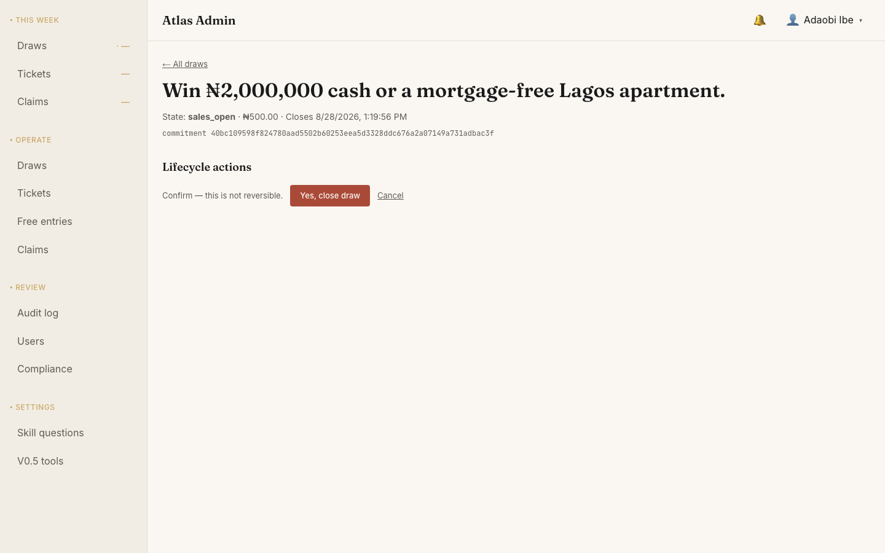

### Draw detail — sales closed

`sales_closed`

State advanced, and the action set with it. Close is gone; reveal is the only move.

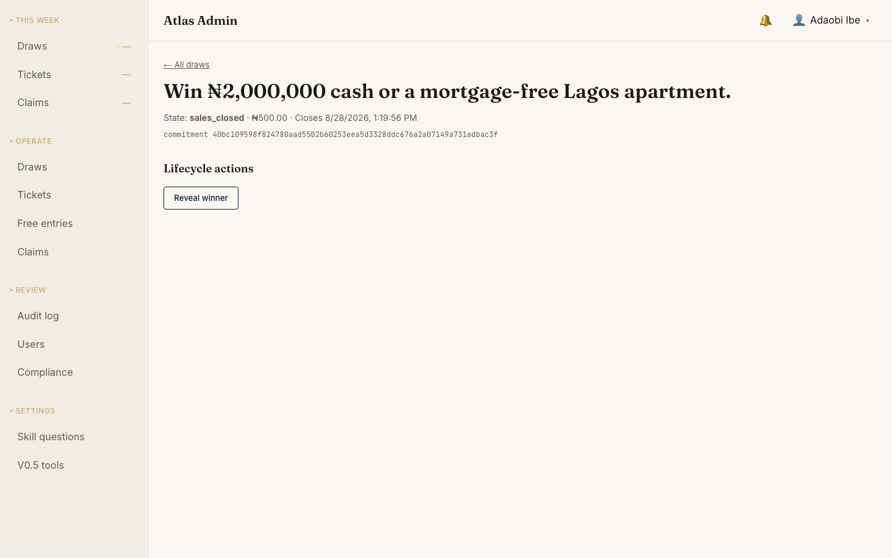

### Draw detail — revealed

`revealed`

Winners selected, draw terminal. The reveal writes an outbox row in the same transaction; the worker dispatched it in ~0.1s. The only remaining action is a link to the public proof.

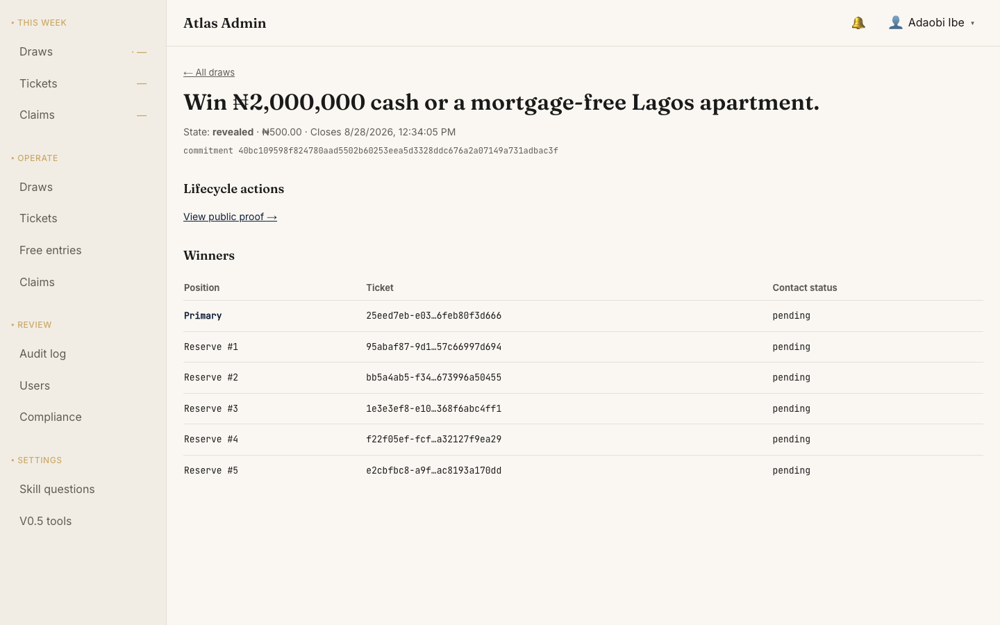

## 4 · Checking the result — anyone

The point of the protocol: the result can be checked by someone with no account and no reason to believe Atlas.

### Public proof — opened

`revealed`

The same URL as the sealed shot in section 1, now carrying the server seed, the drand round and randomness, the tickets hash and the full winner list. The commitment published earlier still matches.

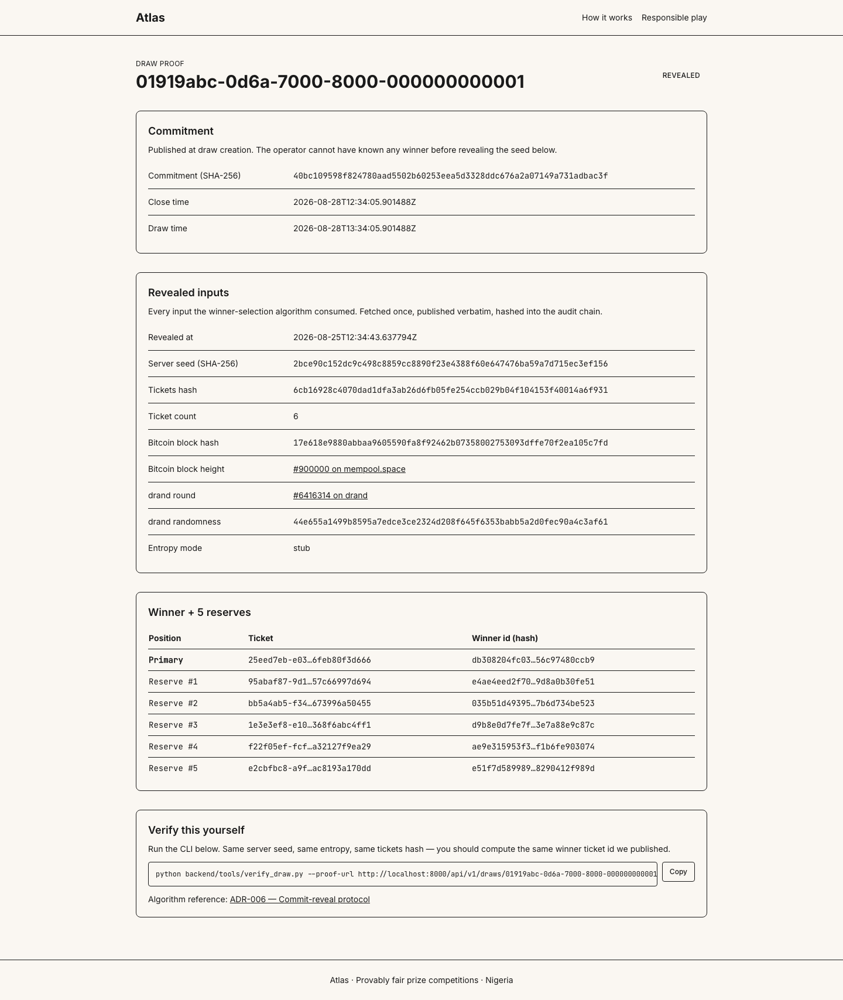

### Verify it yourself

`revealed`

Copy the command, run it against the published proof, recompute the winner independently. The verifier is standalone and needs nothing from Atlas.

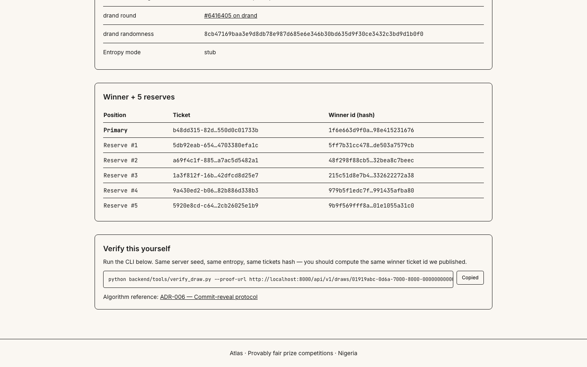

### Hash-chained audit log

`audit`

Every event carries the hash of the one before it (ADR-005). Alter a historical row and every subsequent hash breaks, which the chain check catches on read. That is what makes the log evidence rather than a list.

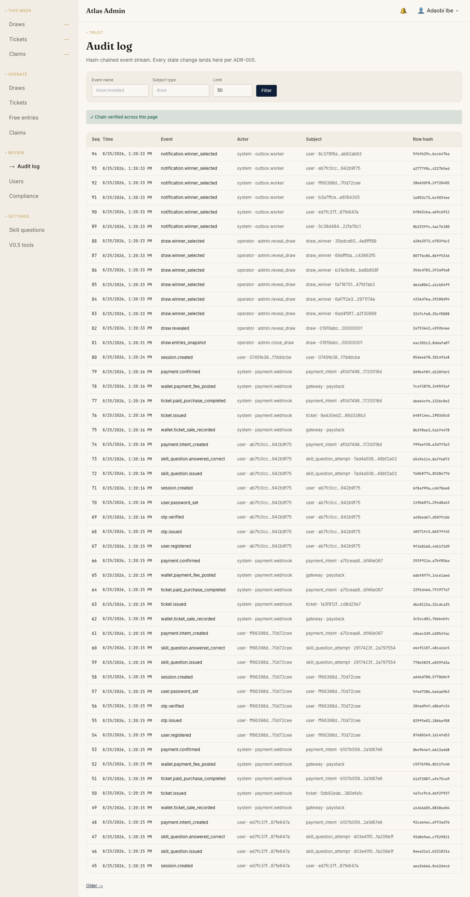

## 5 · Claiming — the winner, back on mobile

### Winner claim

`revealed`

Rendered from the intersection of the tickets a user owns and the draw's winner list, so a user who holds no winning ticket sees the empty state instead.

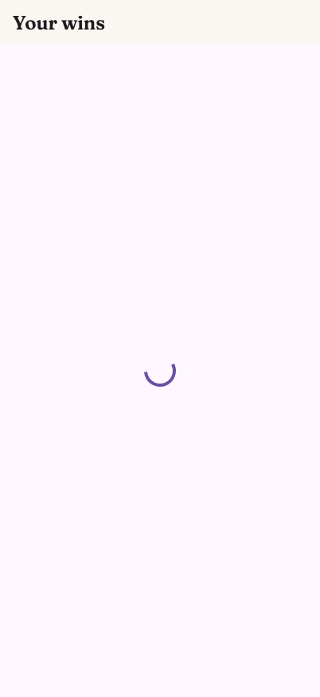

---

## How these were captured

Everything in section 2 and section 5 is a Flutter golden — a widget render, not a device. This is the same build on a booted simulator, device chrome and all, as evidence the app runs rather than merely paints.

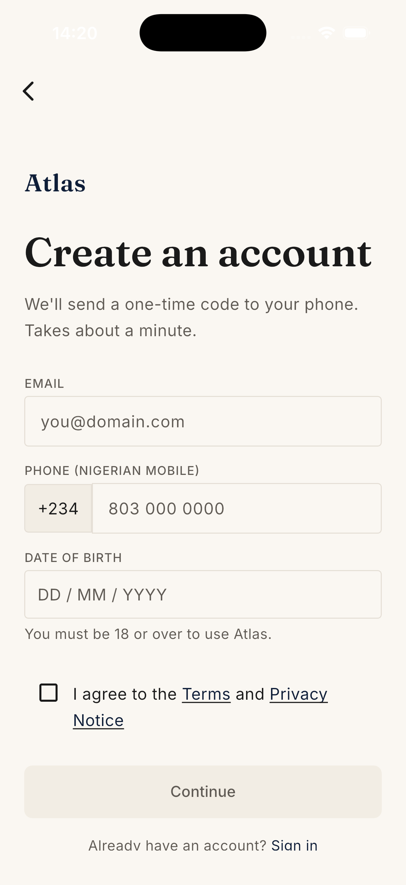

The web shots are driven through a real draw lifecycle by Playwright,
reusing `record_demo.bootstrap_pool` so the flow cannot drift from the
rehearsal script. The mobile goldens render real typography because the
faces are bundled under `mobile/assets/google_fonts/` rather than fetched
at runtime.

Palette and type are the Atlas tokens in
[`_bmad-output/planning-artifacts/design/tokens.md`](../_bmad-output/planning-artifacts/design/tokens.md)
— navy `#0F1E38`, brass `#C9A96A`, Fraunces and Inter.
